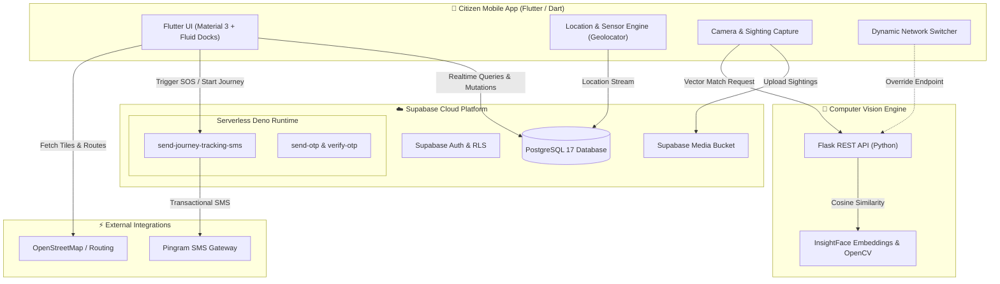

<div align="center">

# 🛡️ UniSafe
### Smart Community Safety, Emergency SOS & AI-Powered Missing Persons Ecosystem

[](https://flutter.dev)
[](https://dart.dev)
[](https://supabase.com)
[](https://www.postgresql.org/)
[](https://deno.land)
[](https://python.org)
[](LICENSE)

<br/>

**UniSafe** is an integrated community protection and emergency response mobile application engineered to safeguard citizens, provide proactive safety measures for women, and accelerate missing person identification through edge cloud services and facial recognition AI.

[Explore Visuals & Screenshots Folder](./unisafe_images/) • [System Architecture](#-system-architecture) • [Key Features](#-core-capabilities) • [Setup & Installation](#-getting-started)

</div>

---

## 📸 Application Gallery & Visuals

> [!TIP]
> All UI captures, device mockups, and walkthrough recordings are organized in the dedicated gallery folder:
> 👉 **[Click here to view the UniSafe Images & Screenshots Directory](./unisafe_images/)**

---

## 🌟 Core Capabilities

### 1. 🚨 Women Safety & "Safe Journey" Protocol
* **Live GPS Route Tracking**: Users initiate journeys with a dynamic destination picker, generating time-bounded, cryptographically signed live web-tracking tokens.
* **Instant Cloud SMS Alerts via Pingram**: Automatically dispatches tracking URLs and GPS links directly to registered trusted contacts via Supabase Edge Functions when a journey starts.
* **Inactivity & Deviation Guard**: Monitors user motion in real-time. If zero movement is detected for a configurable duration (e.g., 10 minutes), an audible "Are you safe?" prompt triggers, escalating automatically to distress dispatch if unconfirmed.
* **Emergency Panic SOS**: One-touch high-priority distress trigger that records exact coordinates to the cloud, updates the authority emergency dashboard, and broadcasts urgent SMS dispatches to all trusted contacts.
* **Trusted Contacts Management**: Secure management of emergency guardians with international E.164 phone normalization (`+91XXXXXXXXXX`).

### 2. 🗺️ Interactive Safety Map & Community Defense
* **Safe Routing Engine**: Powered by OpenStreetMap & OpenRouteService to calculate driving and walking paths supplemented by night activity and lighting scores.
* **Crowdsourced Hazard & Incident Reporting**: Citizens can flag hazards, poorly lit areas, and suspicious activities with geo-tagged verification.
* **Safe Zone Discovery**: Interactive markers identifying nearby police stations, 24/7 pharmacies, hospitals, and designated women safe havens with one-tap directions and emergency calls.
* **Custom Fluid Map UI**: Smooth Flutter map rendering with intuitive navigation docks, location search, and elevation-aware markers.

### 3. 🔍 AI Missing Persons Registry & Facial Matching
* **Public Citizen Bulletin**: Real-time registry of active missing persons with photos, physical descriptions, case codes, and last-seen locations.
* **High-Resilience Cloud Fallbacks**: If the companion AI backend is offline, the app seamlessly falls back to querying Supabase directly, ensuring zero downtime for missing-person lookups.
* **Citizen Sighting Portal**: Citizens upload sighting photos with location data and timestamps using the tamper-proof in-app camera or verified media.
* **Deep Facial Recognition Backend**: A specialized Python/Flask service leveraging **InsightFace** embeddings to compute vector similarities between sighting images and open missing persons records.
* **On-the-Fly Server Switching**: Includes an in-app server configuration panel allowing demoers and testers to switch Flask AI endpoints (local Wi-Fi IP, tunneling URLs, or production cloud) without rebuilding the APK.

---

## 🏗 System Architecture

UniSafe employs an event-driven, decoupled architecture separating mobile interaction, edge dispatch, relational state persistence, and computer vision computation.



---

## 🛠️ Technology Stack

| Domain | Technologies & Libraries |
| :--- | :--- |
| **Mobile Frontend** | **Flutter 3.x**, **Dart 3.x**, Riverpod, Flutter Map, LatLong2, Geolocator, Shared Preferences, Lucide Icons |
| **Backend & Cloud** | **Supabase Cloud**, **PostgreSQL 17**, Row Level Security (RLS), Supabase Realtime (WebSockets) |
| **Serverless Computing** | **Supabase Edge Functions** (Deno, TypeScript) |
| **Telecommunications** | **Pingram SMS API** (Enterprise Indian E.164 transactional & distress SMS) |
| **Artificial Intelligence** | **Python 3.10+**, **Flask**, **InsightFace**, OpenCV, NumPy, Scikit-learn |
| **Mapping & GIS** | **OpenStreetMap**, OpenRouteService, GeoJSON, Haversine Geospatial Geometry |
| **Build & Deploy** | Gradle (Android APK Release with Core Library Desugaring & Cleartext HTTP support) |

---

## 📁 Repository Structure

```text
UniSafe/
├── flutter_app/                     # Core Flutter mobile application
│   ├── android/                     # Android native configs (Manifest, permissions, desugaring)
│   ├── assets/                      # Application icons, themes, and audio assets
│   ├── lib/
│   │   ├── config/                  # Supabase & app configuration
│   │   ├── models/                  # Data models (Citizen, JourneySession, MissingPerson)
│   │   ├── screens/                 # UI Screens
│   │   │   ├── interactive_map/     # Safety Map, hazard reporting, and routes
│   │   │   ├── missing_persons/     # Citizen registry, sighting forms, and server switcher
│   │   │   ├── women_safety/        # Safe Journey, inactivity watcher, and SOS trigger
│   │   │   └── auth/                # Authentication & OTP screens
│   │   ├── services/                # Backend services (SosService, JourneyService, LocationService)
│   │   └── widgets/                 # Reusable UI components & fluid navigation docks
│   └── pubspec.yaml                 # Flutter dependencies and asset registrations
├── supabase/                        # Cloud database & serverless configurations
│   ├── functions/                   # Supabase Edge Functions
│   │   ├── send-journey-tracking-sms/  # Production Pingram SMS dispatch with retry fallback
│   │   └── send-otp/                # Verification OTP pipeline
│   └── migrations/                  # PostgreSQL schema definitions, triggers, and RLS policies
├── unisafe_images/                  # 📸 Portfolio screenshots, videos, and UI demos
└── README.md                        # Master project documentation
```

---

## 🚀 Getting Started

### Prerequisites
* [Flutter SDK](https://docs.flutter.dev/get-started/install) (`>= 3.22.0`)
* [Dart SDK](https://dart.dev/get-dart) (`>= 3.4.0`)
* Android Studio / VS Code with Flutter extension
* Physical Android Device or Emulator running Android 9+ (API 28+)
* Python 3.10+ (if running the companion AI face recognition service locally)

---

### Step 1: Clone the Repository
```bash
git clone https://github.com/itssmansi/UniSafe_fyp.git
cd UniSafe
```

### Step 2: Configure Environment
Ensure your `.env` file exists in `flutter_app/` (or supply build-time environment flags):
```env
SUPABASE_URL=https://your-project.supabase.co
SUPABASE_ANON_KEY=your-anon-key
PINGRAM_API_KEY=your-pingram-api-key
PINGRAM_SMS_TYPE=un1safe_otp
```

### Step 3: Install Dependencies
```bash
cd flutter_app
flutter pub get
```

### Step 4: Run Mobile App
```bash
flutter run
```

### Step 5: (Optional) Run Flask AI Face Recognition
```bash
cd flask_ai
pip install -r requirements.txt
python app.py
```
> *The server will listen on `http://0.0.0.0:5000`. You can configure the IP directly inside the UniSafe app's Missing Persons screen via the server settings icon.*

---

## 🔒 Security & Privacy Engineering

* **Zero Plaintext Secrets in Mobile Binary**: External SMS gateway keys and administrative tokens are strictly executed within isolated Supabase Edge Functions.
* **Signed Ephemeral Tracking Links**: Live journey tracking URLs use cryptographic tokens with 6-hour expiration windows and automatic revocation upon journey conclusion.
* **Row Level Security (RLS)**: PostgreSQL tables are locked down to authenticated citizens, ensuring users can only read/mutate records they are authorized to access.
* **Tamper-Resistant Photo Proofs**: Sighting and incident reports capture timestamped device coordinates at the moment of shutter trigger.

---

## 👨‍💻 Engineering Highlights & Resume Highlights

* **Resilience Under Network Partitioning**: Engineered multi-tiered fallbacks where client applications seamlessly transition between local Flask AI nodes and direct Supabase database streams without user interruption.
* **Sub-Second Distress Latency**: Integrated serverless edge dispatch delivering real-time SMS broadcasts and location links to emergency contacts within seconds of trigger.
* **Hardware & Battery Optimization**: Throttled geofence and accelerometer polling during safe journeys using distance thresholds to minimize battery drain.

---

## 📄 License
This project is developed for educational and portfolio demonstration purposes. All rights reserved.
