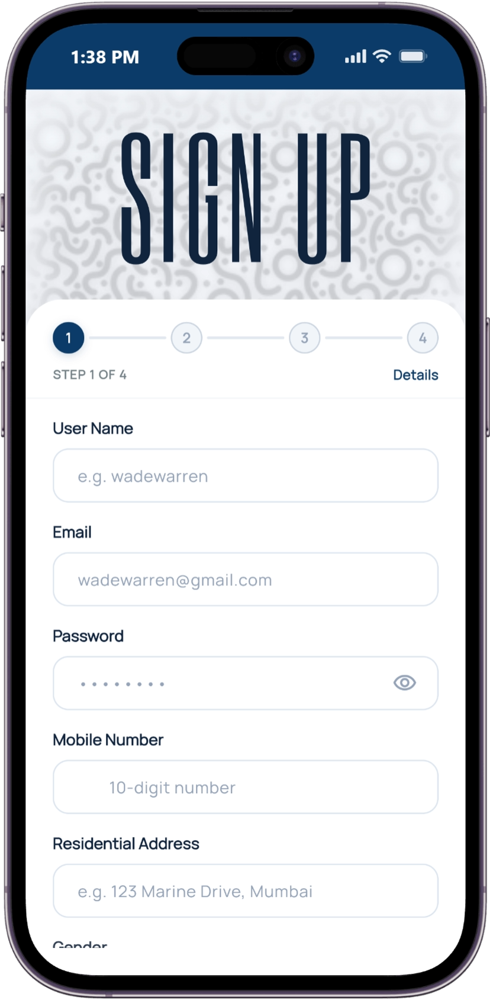
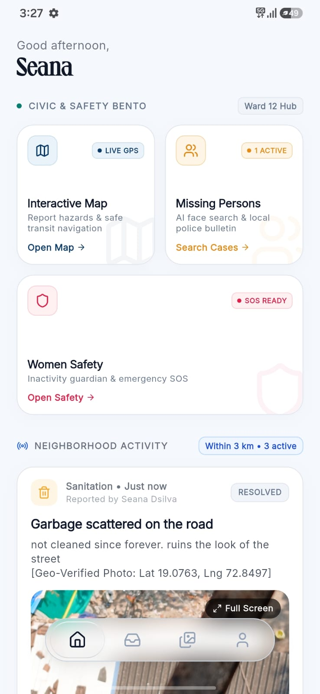
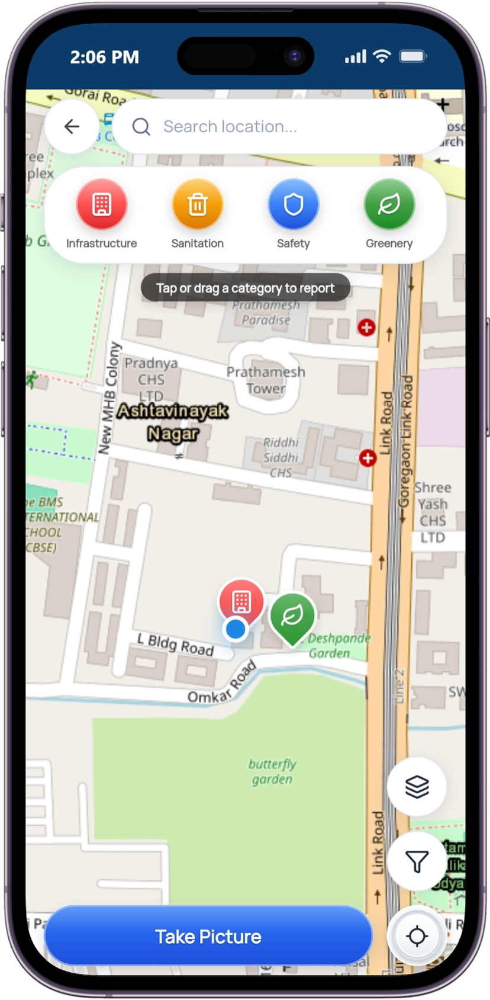
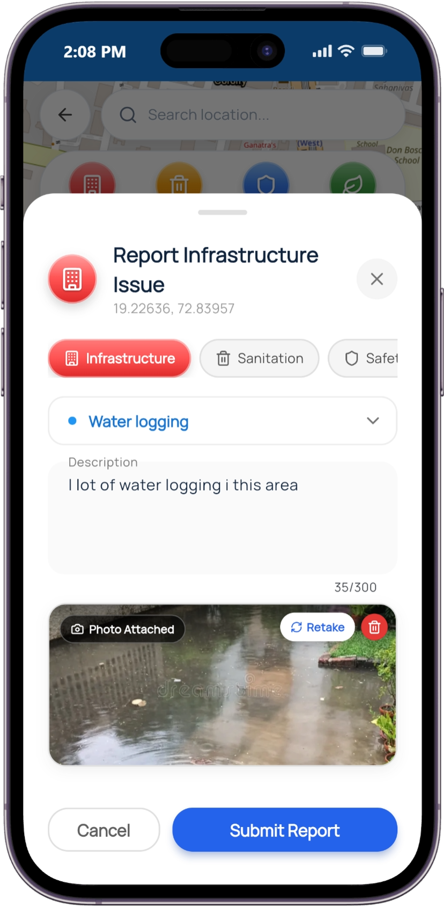
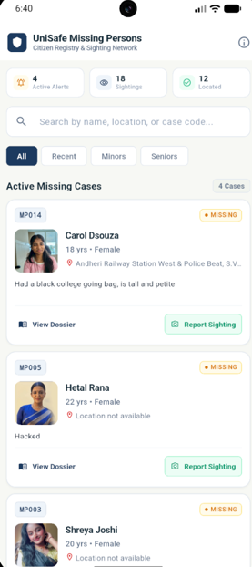
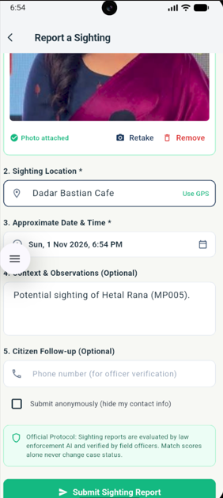
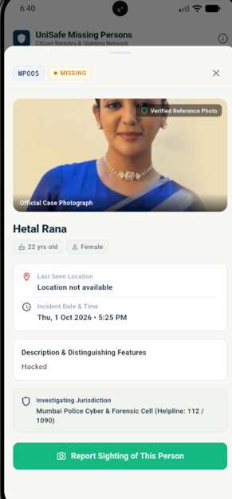
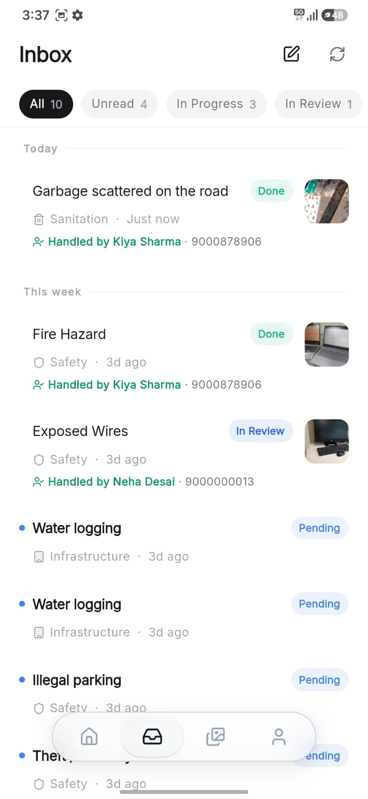
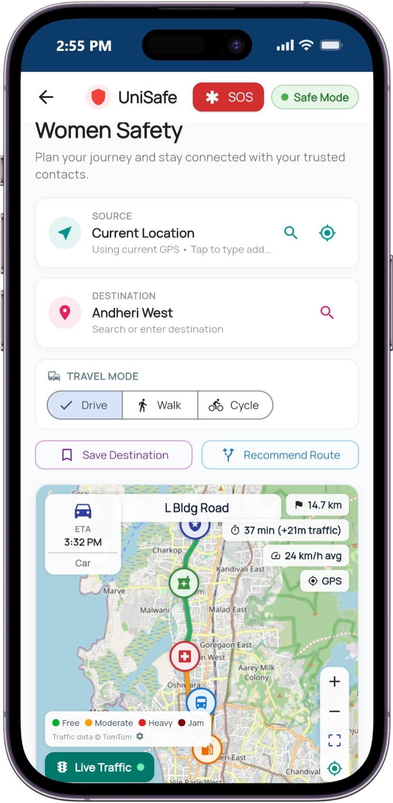

# UniSafe

### Community Safety, Emergency Response & Missing Person Assistance

UniSafe is a community safety mobile application designed to help citizens report local issues, access emergency assistance, stay safe during journeys, and contribute to missing person searches.

## Features

### 1. Citizen Authentication

- Citizen registration and login using Supabase Authentication.
- OTP verification and forgot-password functionality.
- Multi-step sign-up interface with reusable UI components.
- Authenticated user sessions and access to personal complaint history.

### 2. Women's Safety

- SOS emergency alerts to trusted contacts with location sharing.
- Journey planning with source and destination selection.
- Live journey tracking and safe-journey notifications through Pingram SMS.
- Inactivity monitoring to support emergency alerts.
- Nearby help-point identification, including hospitals and police stations.
- Night Activity Score to evaluate safety-related factors along mapped routes.

### 3. Interactive Safety Map

- View nearby safety-related locations.
- Report civic and public safety issues.
- Access location-based information and routes.

### 4. Missing Person Assistance

- Browse registered missing person cases.
- Submit sightings with photographs and location details.
- AI-assisted facial matching to identify potential matches.

### 5. Notifications & Inbox

- Receive updates on reported issues.
- View missing person alerts and relevant notifications.
- Track updates related to submitted reports.

## App Screenshots

### Citizen Login


### Navigation


### Interactive Safety Map
&nbsp;&nbsp;


### Missing Person Assistance
&nbsp;&nbsp;
&nbsp;&nbsp;


### Inbox


### Women's Safety


## Technology Stack

| Component | Technologies |
|---|---|
| Mobile Application | Flutter, Dart |
| Backend & Authentication | Supabase |
| Database | PostgreSQL |
| AI & Image Processing | Python, Flask, InsightFace, OpenCV |
| Maps & Routing | OpenStreetMap, OpenRouteService |
| SMS Integration | Pingram SMS |

## Project Structure

```text
UniSafe/
├── flutter_app/          # Citizen mobile application
│   ├── android/          # Android platform configuration
│   ├── assets/           # Application assets
│   ├── lib/
│   │   ├── config/       # App and Supabase configuration
│   │   ├── models/       # Data models
│   │   ├── screens/      # Application screens
│   │   ├── services/     # Backend and location services
│   │   └── widgets/      # Reusable UI components
│   └── pubspec.yaml      # Flutter dependencies
│
├── supabase/
│   ├── functions/        # Supabase Edge Functions
│   └── migrations/       # Database schema and policies
│
├── unisafe_images/       # Application screenshots and demos
└── README.md
```

## AI Backend

The Flask-based AI backend for the Missing Person Assistance module is maintained separately on the `feature-ai` branch.

It handles facial detection and matching using InsightFace to identify potential matches from submitted sighting photographs.

To access the AI backend:

```bash
git checkout feature-ai
```

The AI service has its own setup and dependencies.

## Getting Started

### Prerequisites

- Flutter SDK
- Dart SDK
- Android Studio or VS Code
- Android emulator or physical Android device

### 1. Clone the Repository

```bash
git clone https://github.com/itssmansi/UniSafe_fyp.git
cd UniSafe_fyp
```

### 2. Configure Environment

Create the required `.env` file inside `flutter_app/` and configure the necessary credentials:

```env
SUPABASE_URL=your_supabase_project_url
SUPABASE_ANON_KEY=your_supabase_anon_key
PINGRAM_API_KEY=your_pingram_api_key
PINGRAM_SMS_TYPE=un1safe_otp
```

### 3. Install Dependencies

```bash
cd flutter_app
flutter pub get
```

### 4. Run the Application

```bash
flutter run
```

## Note

The authority web dashboard is maintained separately from this mobile application repository.

## License

Developed as an academic final-year project.
