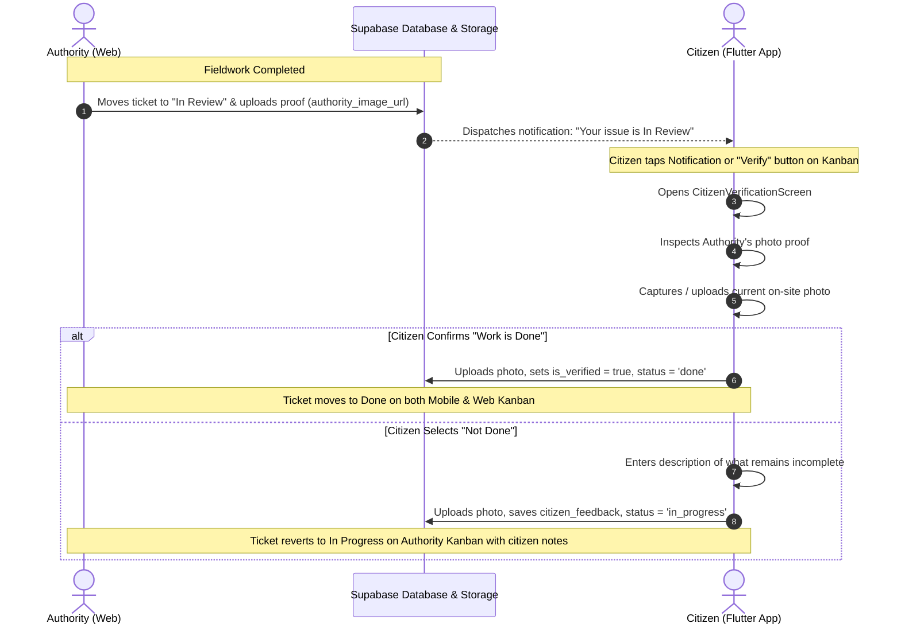

# UniSafe - Citizen Resolution Verification Implementation Plan

**Feature:** Two-Way Authority ↔ Citizen Resolution Verification  
**Platforms:** Flutter Mobile App (Citizen) & React Web Dashboard (Authority)  
**Backend:** Supabase (Database, Auth & Storage)  
**Date:** 2026-10-29  

---

## 1. Feature Overview & Lifecycle

When an authority resolves a reported civic issue on their Web Kanban board, they do not directly close the ticket as completed. Instead:
1. **Authority Action (Web)**: The authority moves the card from `In Progress` to `In Review` and must upload a photo as proof of work done (`authority_image_url`).
2. **Citizen Notification**: The reporting citizen receives a notification alerting them that their issue is now "In Review".
3. **Citizen Verification (Flutter App)**: The citizen taps **"Verify"** (from the notification or directly on the Kanban ticket card / bottom sheet).
4. **Resolution Inspection Screen**:
   - The citizen inspects the **Authority's uploaded proof photo** alongside the original report details.
   - The citizen uploads/captures a **photo of the same location** on-site.
   - The citizen provides their verdict:
     - **"Work is Done"**: Confirms resolution, uploads citizen photo, marks ticket as verified, and moves it to `Done`.
     - **"Not Done"**: Prompts the citizen to write a description of what is still broken or incomplete, attaches their photo, and moves the ticket back to `In Progress` on the Authority's board with their feedback.

---

## 2. Sequence Diagram: Authority ↔ Citizen Handshake



---

## 3. Database Schema Updates (Supabase DDL)

To support this bidirectional flow, the following schema additions will be applied to Supabase:

```sql
-- 1. Ensure authority_image_url exists on public.complaints
ALTER TABLE public.complaints 
ADD COLUMN IF NOT EXISTS authority_image_url text;

-- 2. Store citizen feedback when a resolution is rejected ("Not Done")
ALTER TABLE public.complaints 
ADD COLUMN IF NOT EXISTS citizen_feedback text;

-- 3. Enhance public.complaint_verifications to track feedback comments
ALTER TABLE public.complaint_verifications 
ADD COLUMN IF NOT EXISTS feedback text;

-- 4. Audit logging helper index
CREATE INDEX IF NOT EXISTS idx_complaint_verifications_complaint_id 
ON public.complaint_verifications(complaint_id);
```

---

## 4. Flutter Data Layer & Model Modifications

### File: `flutter_app/lib/screens/interactive_map/report_model.dart`
- **New Fields**:
  ```dart
  final String? authorityImageUrl;
  final String? citizenFeedback;
  ```
- **Updates**:
  - Update `ReportModel` constructor with optional `this.authorityImageUrl` and `this.citizenFeedback`.
  - Update `ReportModel.fromSupabase(Map<String, dynamic> json)`:
    ```dart
    authorityImageUrl: json['authority_image_url']?.toString(),
    citizenFeedback: json['citizen_feedback']?.toString(),
    ```
  - Update `copyWith(...)` method to support both new properties.

---

## 5. New UI: `CitizenVerificationScreen`

### File: `flutter_app/lib/screens/kanban_board_ui/citizen_verification_screen.dart`

### Screen Sections & UX Components:
1. **Header & Ticket Summary**:
   - Issue title, category chip (Infrastructure, Sanitation, Safety, Greenery), and location address.
   - Prominent badge: `Awaiting Citizen Verification`.

2. **Authority Resolution Proof (Inspection Card)**:
   - Displays the photo uploaded by the authority (`authority_image_url`).
   - Tagged: `"Proof Submitted by Authority"`.
   - Tap-to-zoom / lightbox view allowing high-resolution inspection.
   - Side-by-side or tab comparison with the original issue photo (if uploaded by citizen).

3. **Citizen On-Site Photo Capture**:
   - Clean, rounded drop-zone / capture box with Camera (`ImageSource.camera`) and Gallery (`ImageSource.gallery`) triggers via `image_picker`.
   - Real-time image preview with retake and delete controls.
   - Uploads to Supabase Storage: `complaint_images/citizen_verifications/${uuid}.jpg`.

4. **Verdict Decision Controls**:
   - **"Work is Done" Button (Emerald / Green)**:
     - Validates that the citizen attached a verification photo.
     - Inserts record into `public.complaint_verifications`:
       ```json
       {
         "complaint_id": report.id,
         "citizen_id": citizenId,
         "image_url": citizenUploadedUrl,
         "is_verified": true
       }
       ```
     - Updates `public.complaints`:
       ```json
       {
         "status": "done"
       }
       ```
     - Inserts audit log in `public.complaint_logs` (`action: "citizen_verified"`).
     - Displays success dialog and navigates back to refresh the Kanban board.
   
   - **"Not Done" Button (Crimson / Red Outline)**:
     - Toggles open a formatted description box (`TextFormField`):
       - Label: *"What is still pending or incomplete?"*
       - Hint: *"Please describe why this issue is not fully resolved..."*
       - Validator: Requires at least 10 characters so the authority receives actionable feedback.
     - On submission:
       - Inserts record into `public.complaint_verifications`:
         ```json
         {
           "complaint_id": report.id,
           "citizen_id": citizenId,
           "image_url": citizenUploadedUrl,
           "is_verified": false,
           "feedback": feedbackText
         }
         ```
       - Updates `public.complaints`:
         ```json
         {
           "status": "in_progress",
           "citizen_feedback": feedbackText
         }
         ```
       - Inserts audit log in `public.complaint_logs` (`action: "citizen_rejected"`).
       - Informs citizen and updates the Kanban board.

---

## 6. Wiring Up the Trigger Points

### 1. Kanban Board Screen
**File**: `flutter_app/lib/screens/kanban_board_ui/kanban_board_screen.dart`
- Replace dummy `_toggleVerify(report)` stub:
  ```dart
  void _openVerification(CivicReport report) async {
    final result = await Navigator.of(context).push<bool>(
      MaterialPageRoute(
        builder: (_) => CitizenVerificationScreen(report: report),
      ),
    );
    if (result == true) {
      ref.invalidate(reportListProvider);
    }
  }
  ```
- Triggered by:
  - The blue **"Verify"** button on Kanban cards in the `In Review` column (lines 628–650).
  - The **"Verify Report"** button inside the report details bottom sheet (lines 960–990).

### 2. Notification Tap Integration
- When the citizen taps an `in_review` push or in-app notification, the notification payload routes directly to `CitizenVerificationScreen(report: report)`.

---

## 7. Visual Design & Theme Alignment

- Follows the UniSafe design guidelines:
  - Primary Background: `#F8FAFC` / Surface `#FFFFFF`
  - Deep Navy Accent: `#0B192C`
  - Emerald Success: `#10B981`
  - Warning / In-Review Blue: `#2563EB`
  - Danger / Rejection Red: `#EF4444`
  - Elevation: Soft shadow with smooth border radius (`BorderRadius.circular(16)`).
